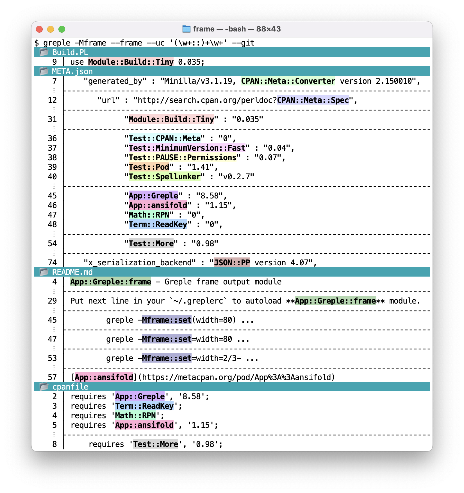
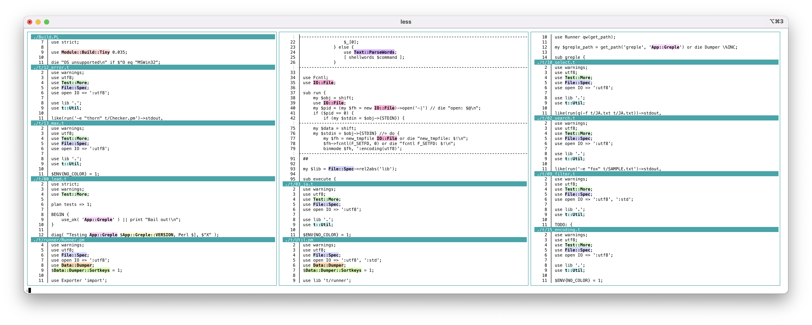
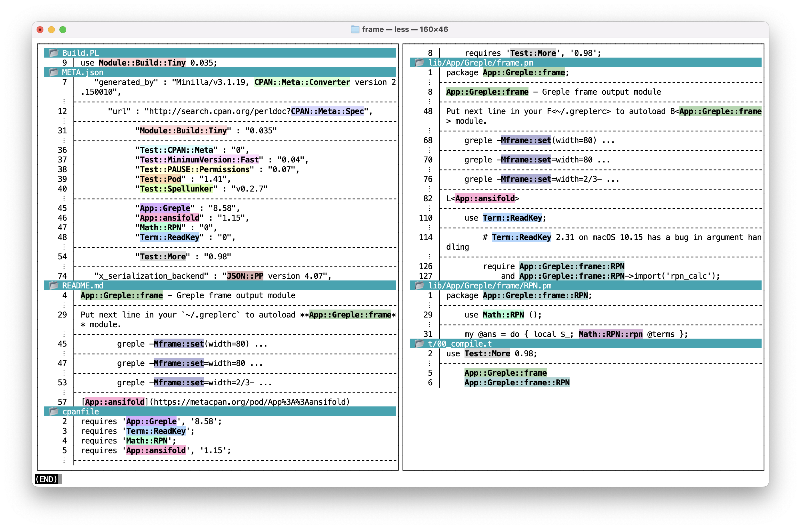

 
# NAME

App::Greple::frame - Greple frame output module

# SYNOPSIS

greple -Mframe --frame ...

# DESCRIPTION

Greple -Mframe module provide a capability to put surrounding frames
for each blocks.

`top`, `middle` and `bottom` frames are printed for blocks.

By default **--join-blocks** option is enabled to collect consecutive
lines into a single block.  If you don't like this, override it by
**--no-join-blocks** option.

# OPTIONS

- **--frame**

    

            

    

    Set frame and fold long lines with frame-friendly prefix string.
    Folding width is taken from the terminal.  Or you can specify the
    width with the **width** parameter.  See ["CONFIGURATION"](#configuration).

- **--frame-cols**

    Output results in multi-column format to fit the width of the
    terminal.  The number of columns is automatically calculated from the
    terminal width.

- **--frame-pages**

    Output results in multi-column and paginated format.

    

            

    

- **--set-frame-width**=_#_

    Set frame width.  You have to put this option before **--frame**
    option.  See ["CONFIGURATION"](#configuration).

# CONFIGURATION

Module parameters are set with [Getopt::EX::Config](https://metacpan.org/pod/Getopt%3A%3AEX%3A%3AConfig) by the **config**
function.  **set** is the same function.

- **config**(**width**=_n_), **set**(**width**=_n_)

    Set terminal width to _n_.  Use like this:

        greple -Mframe::config(width=80) ...

        greple -Mframe::config=width=80 ...

    If non-digit character is found in the value part, it is considered as
    a Reverse Polish Notation, starting terminal width pushed on the
    stack.  RPN `2/3-` means `terminal-width / 2 - 3`.

    You can use like this:

        greple -Mframe::config=width=2/3- --frame --uc '(\w+::)+\w+' --git | ansicolumn -PC2

    An unknown parameter is an error.

    

            

    

# SEE ALSO

[App::ansifold](https://metacpan.org/pod/App%3A%3Aansifold)

[App::ansicolumn](https://metacpan.org/pod/App%3A%3Aansicolumn)

[Math::RPN](https://metacpan.org/pod/Math%3A%3ARPN)

# AUTHOR

Kazumasa Utashiro

# LICENSE

Copyright 2022-2026 Kazumasa Utashiro.

This library is free software; you can redistribute it and/or modify
it under the same terms as Perl itself.
